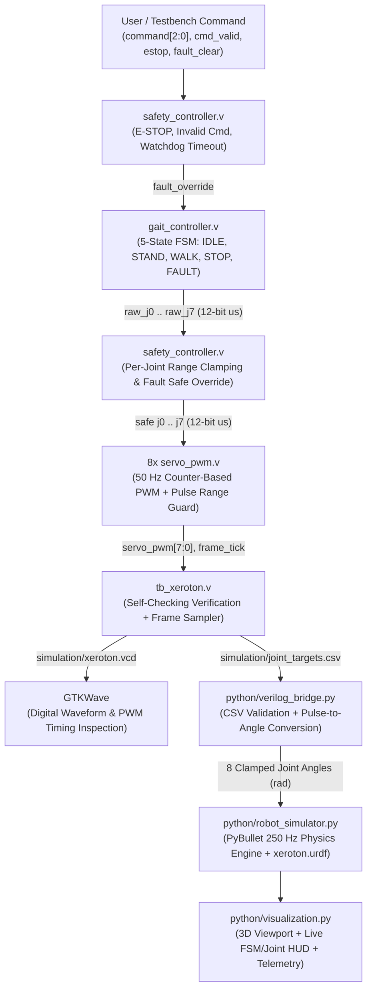

# XEROTON — System Architecture

## 1. Overview & Primary Design Principle

**XEROTON** is an 8-DOF (eight degree-of-freedom) quadruped robot simulation built around a strict hardware-first control architecture:

> **Verilog RTL is the single source of truth for robot movement commands, FSM state transitions, safety overrides, and servo PWM timing. Python + PyBullet strictly visualizes and physically simulates the actual Verilog outputs.**

Python never invents an independent walking animation. Every joint target applied to the 3D robot originates in the Verilog Finite State Machine (`gait_controller.v`), passes through the Verilog hardware safety supervisor (`safety_controller.v`), drives eight independent hardware PWM generators (`servo_pwm.v`), and is exported once per 20 ms PWM frame by the Verilog testbench (`tb_xeroton.v`).

---

## 2. End-to-End Data Flow

---

## 3. Why Verilog + Python?

| Layer | Technology | Role in XEROTON |
|---|---|---|
| **Deterministic Control & PWM Generation** | **Verilog RTL** (`iverilog` + `vvp`) | Models exact cycle-accurate digital hardware: parallel 8-channel PWM timers, synchronous FSM state transitions, 1-clock emergency-stop response, and hardware limit clamping. Directly maps to FPGA fabric (LUTs, flip-flops, counters). |
| **Waveform Verification** | **GTKWave** (`.vcd`) | Lets an ECE engineer inspect clock edges, 20 ms PWM periods, microsecond pulse widths, and fault-override latency visually at the signal level. |
| **3D Rigid-Body Physics & Visualization** | **Python + PyBullet** (`.urdf`) | Verilog simulates digital logic, not gravity, friction, inertia, or ground contact. PyBullet provides a real 3D rigid-body physics engine so we can verify whether Verilog's joint commands keep the quadruped upright and balanced before building physical hardware. |
| **Automated Bridge & Verification** | **Python + pytest** | Validates CSV integrity, VCD timing, pulse-to-angle safety clamping, URDF joint mapping, and physics telemetry automatically. |

---

## 4. Eight-DOF Mechanical & Joint Mapping

XEROTON has **four legs**, each with **two pitch revolute joints** (hip + knee), totaling **8 DOF** and requiring **8 independent PWM channels**:

| Channel | Verilog Signal | URDF Joint Name | Link Pair | Joint Limits (rad) |
|---|---|---|---|---|
| CH0 | `j0` / `servo_pwm[0]` | `front_left_hip` | `base` -> `fl_upper` | `[-0.85, +0.85]` |
| CH1 | `j1` / `servo_pwm[1]` | `front_left_knee` | `fl_upper` -> `fl_lower` | `[-1.05, +1.05]` |
| CH2 | `j2` / `servo_pwm[2]` | `front_right_hip` | `base` -> `fr_upper` | `[-0.85, +0.85]` |
| CH3 | `j3` / `servo_pwm[3]` | `front_right_knee` | `fr_upper` -> `fr_lower` | `[-1.05, +1.05]` |
| CH4 | `j4` / `servo_pwm[4]` | `rear_left_hip` | `base` -> `rl_upper` | `[-0.85, +0.85]` |
| CH5 | `j5` / `servo_pwm[5]` | `rear_left_knee` | `rl_upper` -> `rl_lower` | `[-1.05, +1.05]` |
| CH6 | `j6` / `servo_pwm[6]` | `rear_right_hip` | `base` -> `rr_upper` | `[-0.85, +0.85]` |
| CH7 | `j7` / `servo_pwm[7]` | `rear_right_knee` | `rr_upper` -> `rr_lower` | `[-1.05, +1.05]` |

### Why Eight Separate PWM Channels Are Needed
Each RC hobby servo requires its own continuous 50 Hz pulse stream whose pulse width (typically 1000–2000 us) encodes its angular setpoint. Because front/rear and left/right legs move out of phase during walking (for example, diagonal pair FL+RR lifting while FR+RL push backward), all 8 actuators must receive **simultaneous, independent** PWM signals. In Verilog RTL, instantiating 8 `servo_pwm` modules via a `generate` loop runs all 8 timers in true hardware parallelism with zero CPU interrupt jitter.

---

## 5. Hardware Implementation Paths: FPGA vs. ESP32 + PCA9685

> **Important Distinction:** An ESP32 microcontroller **cannot** directly execute Verilog RTL. Verilog describes digital hardware circuits (flip-flops, counters, combinational gates), whereas an ESP32 executes sequential C/C++/MicroPython software instructions on a CPU core.

| Dimension | Path A: FPGA Hardware (Direct RTL Target) | Path B: ESP32 + PCA9685 (Embedded MCU Alternative) |
|---|---|---|
| **Executes Verilog RTL Directly?** | **Yes** — `rtl/*.v` synthesizes directly to FPGA logic cells (e.g., Xilinx Artix-7 / Basys-3, Intel Cyclone IV/V, Lattice iCE40). | **No** — The FSM and safety logic must be rewritten in C/C++ firmware; Verilog serves only as a reference specification. |
| **PWM Generation** | 8 parallel `servo_pwm` hardware counters inside the FPGA fabric (`CLK_HZ = 50_000_000`). | Offloaded over I2C to an external 16-channel **PCA9685** 12-bit PWM driver IC. |
| **Determinism & Latency** | True hardware parallelism; E-STOP overrides outputs in **1 clock cycle** (20 ns at 50 MHz). | Bounded by firmware loop rate, RTOS scheduling, and I2C bus transaction time (~0.5–2 ms). |
| **Physical Interfacing Needed** | 3.3 V -> 5 V level shifters (if required by servos), dedicated 5 V–6 V high-current servo BEC/battery rail (common ground with FPGA), hardware E-STOP switch, physical endpoint calibration, and IMU/current feedback. | Dedicated 5 V–6 V servo power supply connected to PCA9685 `V+` terminal (never power 8 servos from USB/ESP32 5 V pin), I2C pull-ups, hardware E-STOP cutoff relay, and servo calibration. |
| **When to Choose** | ECE VLSI/FPGA showcase, ultra-low-latency multi-channel control, hardware safety interlocks. | Low-cost wireless prototyping (Wi-Fi/BLE built into ESP32) when an FPGA board is unavailable. |

---

## 6. Current Project Limitations

1. **Open-loop gait in RTL:** The Verilog FSM commands deterministic time-based joint trajectories without closed-loop IMU (roll/pitch) or foot force-sensor feedback.
2. **Simulation clock scaling:** The testbench uses `CLK_HZ = 1_000_000` (1 MHz) for fast desktop RTL simulation while preserving exact 20 ms (50 Hz) servo frames. Targeting a 50 MHz FPGA requires overriding `CLK_HZ = 50_000_000` (already parameterized in `xeroton_top.v` and `servo_pwm.v`).
3. **Un-calibrated visual angle mapping:** The Python bridge maps `1000..2000 us` linearly to `[-0.90, +0.90] rad`. Real hobby servos (e.g., MG996R, DS3218) have unit-to-unit deadband, gear backlash, and horn offset requiring individual calibration before powering physical legs.
4. **No physical hardware actuation:** No GPIO, serial, or motor signals are sent to real hardware in this simulation workspace.
