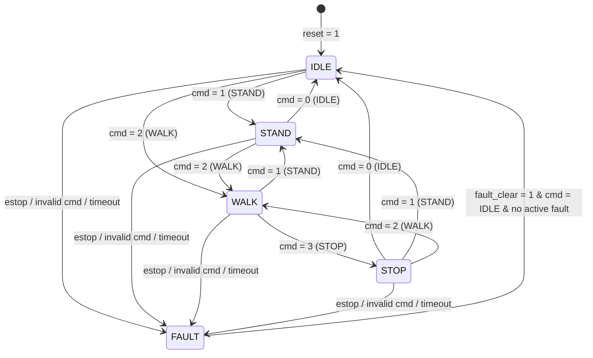

# XEROTON — Verilog RTL Explanation & Timing Calculations

This document explains each Verilog RTL module in `rtl/` and the self-checking testbench in `tb/tb_xeroton.v` in clear, ECE-friendly terms.

---

## 1. Module Hierarchy

```
xeroton_top.v
 ├── gait_controller.v      (5-state FSM -> raw_j0 .. raw_j7)
 ├── safety_controller.v    (E-STOP, invalid cmd, watchdog timeout, pulse clamping -> j0 .. j7)
 └── gen_servo_channels[0..7]
      └── servo_pwm.v       (8 parallel 50 Hz PWM generators -> servo_pwm[7:0])
```

---

## 2. How Clock, Counter, and PWM Generation Work (`rtl/servo_pwm.v`)

Standard RC servos interpret a **50 Hz** pulse-width modulated (PWM) waveform:
- **Frame Period ($T_{\text{frame}}$):**
  $$T_{\text{frame}} = \frac{1}{f_{\text{PWM}}} = \frac{1}{50\text{ Hz}} = 20\text{ ms} = 20{,}000\ \mu\text{s}$$
- **Pulse Width ($t_{\text{pulse}}$):**
  - `1000 us` (1.0 ms): Minimum angle endpoint
  - `1500 us` (1.5 ms): Neutral center (`0.0 rad`)
  - `2000 us` (2.0 ms): Maximum angle endpoint
  - *(Note: Real hobby servos require physical calibration because actual mechanical endpoints vary across manufacturers and models.)*

### Counter & Comparator Math
Inside `servo_pwm.v`, a 32-bit synchronous counter `count` increments on every rising clock edge from `0` to `FRAME_TICKS - 1`, then wraps back to `0`:

$$\text{FRAME\_TICKS} = \frac{\text{CLK\_HZ}}{\text{PWM\_HZ}}, \qquad \text{TICKS\_PER\_US} = \frac{\text{CLK\_HZ}}{1{,}000{,}000}$$

$$\text{pulse\_ticks} = \text{clamped\_pulse\_us} \times \text{TICKS\_PER\_US}$$

| Target Platform | `CLK_HZ` | `PWM_HZ` | `TICKS_PER_US` | `FRAME_TICKS` (20 ms) | `1500 us` Pulse Ticks |
|---|---|---|---|---|---|
| **Desktop Simulation** (default) | 1,000,000 Hz (1 MHz) | 50 Hz | 1 tick/us | 20,000 ticks | 1,500 ticks |
| **50 MHz FPGA Board** (e.g., DE10-Lite / Basys-3) | 50,000,000 Hz (50 MHz) | 50 Hz | 50 ticks/us | 1,000,000 ticks | 75,000 ticks |
| **100 MHz FPGA Board** (e.g., Artix-7 Nexys) | 100,000,000 Hz (100 MHz) | 50 Hz | 100 ticks/us | 2,000,000 ticks | 150,000 ticks |

### Glitch-Free Shadow Registering & Defense-in-Depth Protection
1. **Valid pulse-range protection:** Combinational bounds logic clamps any input below `MIN_PULSE_US` (1000 us) up to `1000 us`, and any input above `MAX_PULSE_US` (2000 us) down to `2000 us`, asserting `pulse_clamped = 1`.
2. **Frame-synchronous latching:** `frame_tick` asserts for 1 clock cycle at `count == FRAME_TICKS - 1`. On that edge, `gait_controller` updates the 8 targets. On the next cycle (`count == 0`), `servo_pwm` latches the new clamped target into `active_pulse_us` for the entire 20 ms frame.
3. **Registered comparator:** `pwm <= (count < pulse_ticks)` produces an exact-duration HIGH pulse of `active_pulse_us * TICKS_PER_US` clock cycles with zero combinational glitches.

---

## 3. What the Finite State Machine Does (`rtl/gait_controller.v`)

A **Finite State Machine (FSM)** is a sequential digital circuit that stays in one of a finite number of named states and moves deterministically between them based on inputs (`command`, `cmd_valid`, `estop`, `fault_active`, `reset`) at rising clock edges.



### State Table & Joint Policies

| State | Code | Trigger | Joint Target Policy |
|---|---|---|---|
| **IDLE** | `3'd0` | Reset or `command == 0` | All 8 joints at `1500 us` neutral |
| **STAND** | `3'd1` | `command == 1` | Symmetric crouched stance: Hips = `1350 us` (-0.27 rad), Knees = `1800 us` (+0.54 rad), aligning each foot directly below its hip |
| **WALK** | `3'd2` | `command == 2` | Deterministic **8-phase zero-scrubbing diagonal trot** (`FRAMES_PER_PHASE = 4` -> 80 ms/phase, 640 ms/stride cycle) alternating Pair A (`FL + RR`) and Pair B (`FR + RL`) with double-support transfer phases (Phases 3 & 7) |
| **STOP** | `3'd3` | `command == 3` | Halts walking immediately, resets `gait_phase = 0`, commands safe standing pose (`1350 us` hips / `1800 us` knees) |
| **FAULT** | `3'd4` | E-STOP, invalid command (`> 3`), or watchdog timeout | Immediate 1-clock transition; overrides all 8 channels to `1500 us` safe neutral and stays latched until cleared |

### Lift-First Zero-Scrubbing 8-Phase Diagonal Trot Table (Phase 8 Physics-Tuned)

| Phase | Pair A (`FL: j0,j1` & `RR: j6,j7`) | Pair B (`FR: j2,j3` & `RL: j4,j5`) | Mechanical Action |
|---|---|---|---|
| `0` | Hip `1350`, Knee `1940` (Lift/mid-air) | Hip `1350`, Knee `1800` (Stance mid) | Pair A lifts off cleanly from STAND with zero scrub |
| `1` | Hip `1270`, Knee `1940` (Swing fwd) | Hip `1430`, Knee `1800` (Stance rear) | Pair B pushes body `+X` forward; Pair A reaches forward |
| `2` | Hip `1270`, Knee `1800` (Plant fwd) | Hip `1430`, Knee `1800` (Hold rear) | **Double support** (4 feet grounded, zero hip scrubbing) |
| `3` | Hip `1270`, Knee `1800` (Hold fwd) | Hip `1430`, Knee `1940` (Lift rear) | **Lift-first**: Pair B clears ground before swinging forward |
| `4` | Hip `1350`, Knee `1800` (Stance mid) | Hip `1350`, Knee `1940` (Swing mid) | Pair A pushes body `+X` forward; Pair B swings mid-air |
| `5` | Hip `1430`, Knee `1800` (Stance rear) | Hip `1270`, Knee `1940` (Swing fwd) | Pair A completes `+X` push; Pair B reaches forward |
| `6` | Hip `1430`, Knee `1800` (Hold rear) | Hip `1270`, Knee `1800` (Plant fwd) | **Double support** (4 feet grounded, zero hip scrubbing) |
| `7` | Hip `1430`, Knee `1940` (Lift rear) | Hip `1270`, Knee `1800` (Hold fwd) | **Lift-first**: Pair A clears ground before swinging forward |

---

## 4. Hardware Safety Supervisor (`rtl/safety_controller.v`)

`safety_controller.v` enforces four independent hardware safety policies:

1. **Emergency Stop (`estop` -> `fault_code[0]`):** Latches `fault_active` on the very next clock edge and drives `fault_override` combinationally so `gait_controller.state` and all 8 servo targets override to `1500 us` in lockstep.
2. **Invalid Command Trap (`cmd_valid && command > 3` -> `fault_code[1]`):** Rejects undefined command codes (`4..7`) and forces `FAULT`.
3. **Communication Watchdog (`watchdog_enable && !cmd_valid` for `TIMEOUT_FRAMES` -> `fault_code[2]`):** Protects against host/controller link loss by automatically faulting after `TIMEOUT_FRAMES` consecutive 20 ms frames without a valid command strobe.
4. **Per-Joint Pulse Clamping (`limit_clamped[7:0]`, `fault_code[3]`):** Clamps hip channels (`j0, j2, j4, j6`) to `[1100, 1900] us` and knee channels (`j1, j3, j5, j7`) to `[1050, 1950] us` before feeding the 8 `servo_pwm` channels (which independently enforce `[1000, 2000] us`).
5. **Safe Latched Recovery:** Releasing `estop` while `command == WALK` does **not** resume walking; the operator must command `IDLE` or `STOP` and pulse `fault_clear` (or `reset`).

---

## 5. Self-Checking Verification Testbench (`tb/tb_xeroton.v`)

`tb_xeroton.v` simulates **150 complete 20 ms PWM frames (3.00 seconds)** at `1 MHz` and performs 41 automated assertions plus continuous real-time edge measurement on `servo_pwm[0]` and `servo_pwm[1]`:

- Measures rising-edge-to-rising-edge period across every frame (verifying `20,000.00 us ± 1 us` = `50.00 Hz`).
- Measures rising-edge-to-falling-edge pulse width across every frame (verifying exact match to `j0` and `j1` in microseconds).
- Verifies standalone out-of-range clamping (`500 us -> 1000 us` and `2500 us -> 2000 us` on `servo_pwm`; `800 us -> 1100 us` and `2300 us -> 1950 us` on `safety_controller`).
- Exports `simulation/xeroton.vcd` for GTKWave and `simulation/joint_targets.csv` for the Python/PyBullet bridge.
